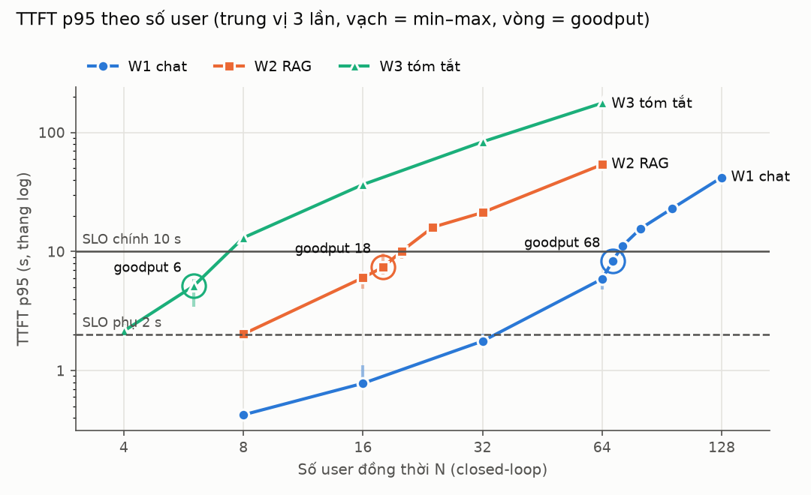
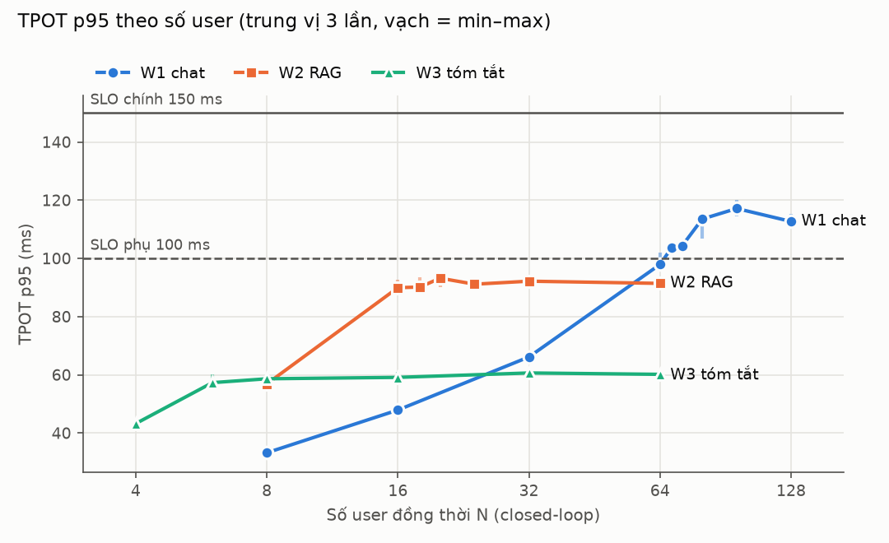
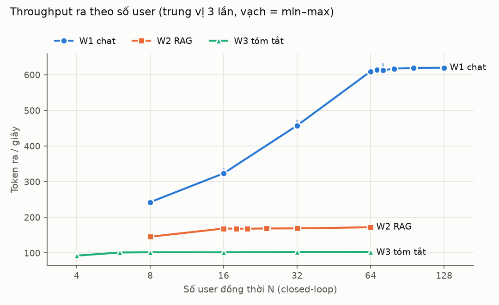
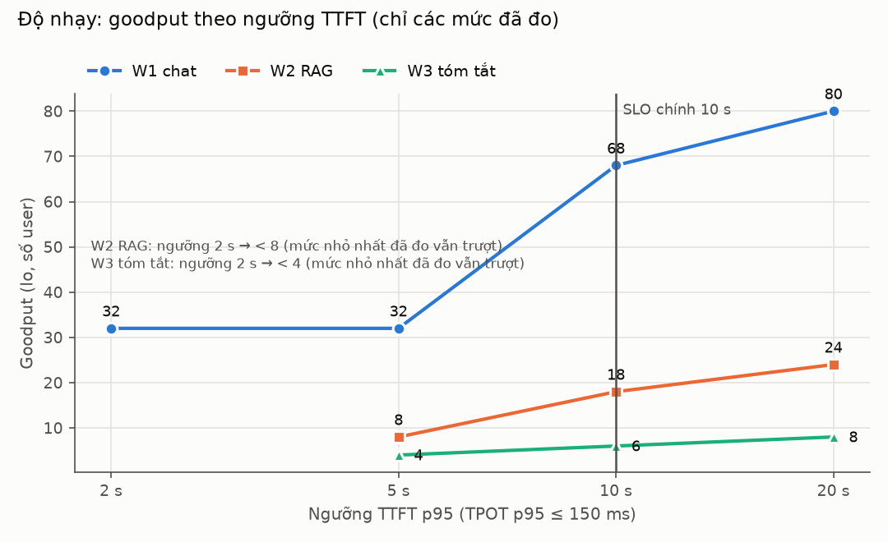

# P04 — Đọc ngay: vLLM mặc định phục vụ được bao nhiêu người trên một L4

> Bản dễ đọc, kể lại từng bước. Bản đầy đủ số liệu: [bao-cao.md](bao-cao.md).

**Một câu:** chạy 4 giờ 26 phút trên L4, tốn khoảng **32,700 VND**. Kết quả: vLLM mặc định phục vụ được cùng lúc
**68 người chat**, **18 người hỏi RAG**, hoặc **6 người tóm tắt hợp đồng** mà vẫn đạt mức phục vụ đã chọn. Cả ba trường hợp đều hỏng vì
**người dùng phải chờ quá lâu mới thấy chữ đầu tiên**, không phải vì chữ chạy chậm. Nguyên nhân gốc là **thiếu bộ nhớ KV cache**.

---

## 0. Nhắc lại: đang đo cái gì

- **Ba bài đo** (workload), mỗi bài chỉ một loại câu hỏi:

  | Bài | Câu hỏi | Độ dài vào / ra (token) |
  |---|---|---|
  | W1 | chat ngắn (ShareGPT) | ~410 / ~330 |
  | W2 | hỏi đáp trên tài liệu, RAG (RAGBench) | ~2,860 / ~170 |
  | W3 | tóm tắt hợp đồng (CUAD) | ~5,600 / ~300 |

- **"N người dùng"**: N luồng, mỗi luồng gửi câu hỏi, chờ trả lời xong rồi gửi câu tiếp ngay (không nghỉ). Server luôn có N câu.
- **Đạt** khi cả hai điều đúng:
  - **TTFT p95 ≤ 10 s**: 95% câu hỏi thấy chữ đầu tiên trong vòng 10 giây.
  - **TPOT p95 ≤ 150 ms**: chữ chạy ít nhất ~6.7 token/giây, nhanh hơn tốc độ đọc.
- **Goodput** = N lớn nhất còn đạt. Ghi dạng "68 (72 trượt)": 68 đạt, 72 trượt.
- Mỗi mức N đo **3 lần**, mỗi lần một bộ câu hỏi khác nhau. Đạt hay trượt quyết định theo **lần ở giữa** (trung vị), vì P03 cho thấy TTFT p95 của một lần đo dao động ~20%.

---

## 1. Chạy

P04 chạy ngay sau P03, trên **cùng máy** (không tắt máy, khỏi cài lại):

```bash
tmux new -d -s exp "bash scripts/remote_bench.sh bench/configs/full.yaml /root/results/p04"
```

| Phần | Nghĩa |
|---|---|
| `tmux new -d -s exp "..."` | Chạy trong phiên tmux tên `exp` trên máy thuê; laptop mất mạng thì vẫn chạy |
| `remote_bench.sh` | Cài đặt (đã có nên bỏ qua) → đo → tổng hợp |
| `full.yaml` | Chế độ **tự tìm goodput**, mỗi mức 3 lần |

Trên laptop có hai việc chạy nền:
- kéo kết quả về mỗi 2 phút (`rsync`);
- một "lệnh canh" kiểm tra máy thuê mỗi phút, đánh thức tôi khi có lỗi, khi xong, hoặc sau 30 phút (theo yêu cầu của bạn). Tôi kiểm tra 8 lần, không lần nào thấy lỗi.

---

## 2. Công cụ tự tìm điểm gãy như thế nào (đúng lần chạy này)

```
Đợt 1 (lưới gốc, 36 lần đo, ~2.7 giờ):
   W1:  8 ✓  16 ✓  32 ✓  64 ✓      → 64 vẫn đạt → phải đo lên
   W2:  8 ✓  16 ✓  32 ✗  64 ✗      → điểm gãy giữa 16 và 32
   W3:  8 ✗  16 ✗  32 ✗  64 ✗      → 8 đã trượt → phải đo xuống
Đợt 2:  W1 128 ✗   W2 24 ✗   W3 4 ✓
Đợt 3:  W1  96 ✗   W2 20 ✗   W3 6 ✓  → W3 xong: 6 (8 trượt)
Đợt 4:  W1  80 ✗   W2 18 ✓            → W2 xong: 18 (20 trượt)
Đợt 5:  W1  72 ✗
Đợt 6:  W1  68 ✓                      → W1 xong: 68 (72 trượt)
```

Mỗi đợt gồm các mức cần đo × 3 lần. Công cụ dừng khi khoảng giữa mức đạt và mức trượt hẹp hơn 2 người, hoặc hẹp hơn 10% số người.
Tổng cộng 22 mức × 3 = **66 lần đo**, không câu hỏi nào lỗi.

Giữa các lần lặp của đợt 1, server được tắt và bật lại. Cả hai lần bật đều có KV cache 37,264 token (đúng mức bình thường; P03 đã chỉ ra lần biên dịch đầu cho KV nhỏ hơn).

---

## 3. Kết quả

### Goodput

| | Goodput (SLO chính 10 s / 150 ms) | Nếu đòi khắt khe hơn: 2 s / 100 ms |
|---|---|---|
| **W1** chat | **68** (72 trượt) | 32 (64 trượt) |
| **W2** RAG | **18** (20 trượt) | dưới 8 |
| **W3** tóm tắt | **6** (8 trượt) | dưới 4 |



Cách đọc hình:
- Trục ngang là số người dùng, mỗi vạch gấp đôi vạch trước.
- Trục dọc là TTFT p95 tính bằng giây. Thang log: mỗi vạch lớn gấp 10 lần vạch trước.
- Đường ngang liền là ngưỡng 10 s; đường gạch là 2 s. Vòng tròn đánh dấu goodput.
- Ba đường đều đi lên rất dốc sau điểm gãy. Ví dụ W2: 6 s ở 16 người, 16 s ở 24, 54 s ở 64.

### Chữ chạy có chậm không? Không



- TPOT p95 cao nhất là 117 ms (W1, 96 người), vẫn dưới ngưỡng 150 ms.
- Đường W2 và W3 nằm ngang ngay sau điểm gãy, ở ~90 ms và ~60 ms. Nghĩa là thêm người thì chữ không chạy chậm hơn.
- Người dùng chỉ phải **chờ lâu hơn** trước khi chữ bắt đầu chạy.

### Vì sao: KV cache chỉ đủ cho một số câu hỏi

KV cache là phần bộ nhớ GPU lưu thông tin của các token đã đọc. Mỗi câu hỏi đang chạy chiếm một phần. Máy có **37,264 token** KV.

Server tự báo số câu đang chạy. Khi đã quá tải thì con số này **đứng yên**:

| Bài | Câu đang chạy cùng lúc | 37,264 ÷ số câu | So với một câu hỏi |
|---|---|---|---|
| W1 | ~60 | ~620 token | Một câu chat đang sinh dở: ~410 vào + một phần ~330 ra |
| W2 | ~15 | ~2,480 token | Một câu RAG: ~2,860 token, trong đó 622 token system prompt dùng chung |
| W3 | ~6 | ~6,200 token | Một hợp đồng: ~5,600 + 300 |

→ **Số câu chạy được cùng lúc = bộ nhớ KV ÷ kích thước một câu.** Người thứ 61 (W1), 16 (W2), 7 (W3) trở đi phải xếp hàng.

Server cũng tự báo TTFT gồm những phần nào:

| Mức | TTFT trung bình | Trong đó: chờ trong hàng | Tính toán (prefill) |
|---|---|---|---|
| W1, 68 người | 3.35 s | **2.79 s** | 0.45 s |
| W2, 18 người | 3.83 s | **2.78 s** | 0.88 s |
| W3, 8 người | 7.23 s | **5.68 s** | 1.43 s |

→ Phần lớn thời gian người dùng nhìn màn hình trống là **chờ đến lượt**, không phải chờ GPU tính.

### Throughput (chữ ra mỗi giây)



- Sau điểm gãy, throughput đi ngang: W1 ~615, W2 ~169, W3 ~102 token ra mỗi giây. Thêm người không làm máy làm được nhiều hơn.
- So với giả định trong plan.md:

  | | Giả định | Đo được |
  |---|---|---|
  | W1, 8 / 16 / 32 / 64 người (token ra/giây) | 260 / 380 / 520 / 600 | 243 / 323 / 458 / 610 |
  | Tốc độ đọc prompt (prefill, token/giây) | 5,000 | ~2,780 (W2), ~1,940 (W3) |

  Decode gần đúng giả định. Prefill chỉ được ~40–55% giả định.
- Một phần lý do: GPU **luôn chạy ở trần điện 72 W**, nên tự hạ xung nhịp xuống ~1,100 MHz, khoảng một nửa mức tối đa. Điều này đúng ở mọi mức đo.

### Nếu hội đồng chọn ngưỡng khác



Goodput tính lại từ cùng dữ liệu với các ngưỡng TTFT 2 / 5 / 10 / 20 s, không đo thêm. Ví dụ ngưỡng 20 s: W1 80, W2 24, W3 8.
Các con số ngoài 10 s chỉ chính xác tới các mức đã đo. Ví dụ "W1 ở 5 s là 32" nghĩa là điểm gãy nằm đâu đó giữa 32 và 64.

---

## 4. Hai điểm cần nói thẳng

**W2 có thể là 18 hoặc 20.**
- Ở 20 người, ba lần đo cho TTFT p95 = 11.1 s, **8.8 s**, 10.1 s. Hai lần trượt, lần ở giữa là 10.06 s, chỉ trên ngưỡng 0.06 s.
- Nếu bỏ đợt đầu và đoạn cuối của mỗi lần đo (cách tính "steady" bạn hỏi ở P03) thì 20 đạt.
- Tôi giữ **18** vì đó là quy tắc đã chốt trước khi đo. Đổi quy tắc sau khi thấy số là không trung thực.
- Kết luận đúng: **điểm gãy W2 nằm quanh 18–20 người**. Từ đây, hai cấu hình chỉ được coi là khác nhau khi goodput chênh **nhiều hơn một bước** (hơn 2 người ở W2).

**TTFT p95 dao động ~16% giữa các lần đo** (trung vị trên 22 mức). Có mức gần 50%.
Throughput và TPOT dao động dưới ~5%. Điều này khớp P03, đã ghi ở challenges.md #5.

---

## 5. Dòng thời gian và chi phí

```
00:19:15  bắt đầu P04 (máy đã chạy từ P03)
01:10     xong lần lặp 1 của lưới gốc → khởi động lại server
02:04     xong lần lặp 2 → khởi động lại server
02:59     xong lưới gốc (36 lần đo)
02:59–04:45  5 đợt tìm điểm gãy (30 lần đo)
04:45:06  xong toàn bộ
04:45:50  kéo hết kết quả về laptop (đủ 66/66), destroy máy, kiểm tra còn 0 máy
```

**Hoá đơn Vast cho cả phiên P03 + P04** (một máy):

```
GPU      5.251 giờ   $1.400
Ổ đĩa    5.265 giờ   $0.088
Tải về   21.2 GB     $0.028
Tổng                 $1.516 ≈ 39,700 VND     (số dư $9.870 → $8.353)
```

Chia theo thời gian: P03 ≈ 7,000 VND, **P04 ≈ 32,700 VND** (4.44 giờ). Ước trước khi chạy là 5.1 giờ.

---

## 6. Rút ra điều gì

1. **Trên L4, nghẽn đầu tiên là bộ nhớ KV, không phải tốc độ tính.** Cả ba bài đều hỏng vì hàng đợi, trong khi chữ vẫn chạy đủ nhanh.
2. **Bài tune đầu tiên của GĐ1 là tăng chỗ cho KV:**
   - lưu KV bằng 8 bit (FP8) để gấp đôi số token;
   - cho vLLM dùng nhiều hơn 92% bộ nhớ.
   P03 đã thấy chỉ +30% KV làm TTFT p95 của W2 giảm một nửa.
3. **W1 bị tạm dừng (preemption) 100–330 lần mỗi lần đo** khi quá tải. vLLM nhận thêm câu hỏi khi còn chỗ cho prompt, rồi phải tạm dừng khi các câu trả lời dài ra. Có thể tune bằng giới hạn số câu chạy cùng lúc.
4. **Prefill chậm hơn giả định ~2 lần.** Cần profile ở GĐ3, nhớ rằng GPU chạy ở ~1.1 GHz do trần điện.

## Bước tiếp theo (không làm trong phiên này)

**P05 (W4, tải giống thật):**
- Phép tính từ năng lực đo ở P04 cho trần ~**k = 22** "ngày người dùng" ở giờ cao điểm. Đề xuất bắt đầu đo ở k = 16 và 24.
- Ước **5–5.6 giờ GPU ≈ 38–43k VND**.
- Trước khi thuê máy cần thêm chế độ chạy W4 vào `sweep.py` để chạy tiếp được và có `--status` (làm ở laptop, không tốn tiền).
